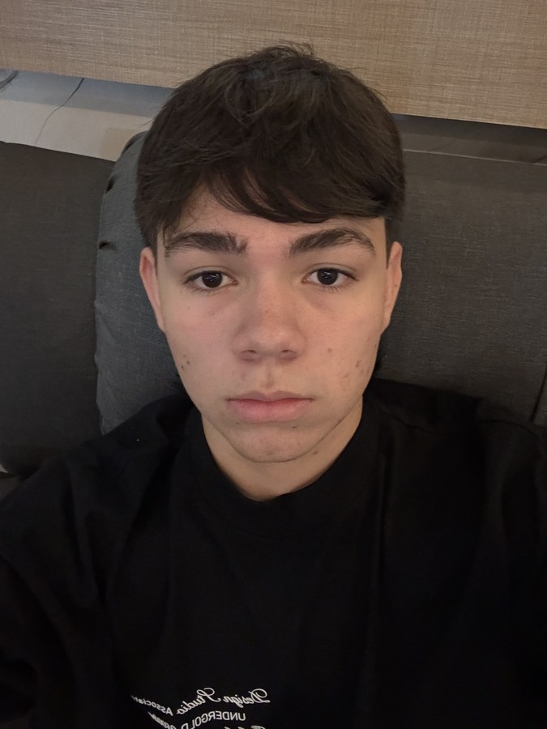
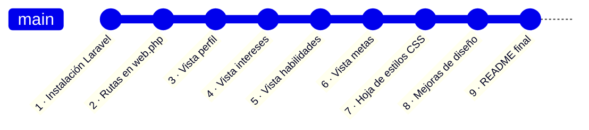

# Mi Perfil — Taller Básico de Laravel



**Autor:** Camilo Calderón
**Asignatura:** Desarrollo Backend
**Docente:** Fabián Enrique Suárez Carvajal
**Universidad Autónoma de Bucaramanga** — Facultad de Ingeniería
**Fecha:** 13 de agosto de 2026

<br clear="right">

---

## 📖 Descripción

Aplicación web desarrollada con **Laravel** como parte del taller básico de introducción al framework. El proyecto presenta un perfil personal a través de varias vistas navegables construidas con **Blade**, con un diseño propio en **CSS puro** (sin Bootstrap ni ningún framework de estilos).

La dirección visual es un **cartel editorial risográfico**: papel crudo con grano, tinta negra y un duotono bermellón / azul eléctrico con desregistro de impresión, retícula suiza y tipografía monumental.

---

## 🗂️ Vistas del proyecto

| Ruta | Vista | Contenido |
|---|---|---|
| `/perfil` | `perfil.blade.php` | Información personal |
| `/perfil/intereses` | `intereses.blade.php` | Pasatiempos y gustos |
| `/perfil/habilidades` | `habilidades.blade.php` | Skills técnicas |
| `/perfil/metas` | `metas.blade.php` | Objetivos profesionales |

Todas las vistas comparten un menú de navegación y la hoja de estilos `public/css/estilos.css`.

---

## ⚙️ Requisitos del sistema

- **PHP** 8.4 o superior
- **Composer** 2.x
- **Node.js** 20 o superior y **npm** (solo para compilar los assets de la página de inicio)
- **Git**
- Un servidor local (XAMPP, Laragon o el servidor integrado de Laravel)

---

## 🚀 Instrucciones de instalación

**1. Clonar el repositorio**

```bash
git clone https://github.com/CamiloCalder0n/mi-perfil.git
cd mi-perfil
```

**2. Instalar las dependencias de PHP**

```bash
composer install
```

**3. Instalar las dependencias de JavaScript**

```bash
npm install
```

**4. Crear el archivo de entorno y generar la clave de la aplicación**

```bash
cp .env.example .env
php artisan key:generate
```

**5. Preparar la base de datos**

El proyecto usa **SQLite**, así que no hace falta configurar ningún motor externo:

```bash
touch database/database.sqlite
php artisan migrate
```

**6. Compilar los assets**

```bash
npm run build
```

> ⚠️ Este paso es **obligatorio**. La carpeta `public/build/` está excluida del repositorio, por lo que los assets compilados no se descargan al clonar. Si se omite, la página de inicio falla con el error `Unable to locate file in Vite manifest`. Las vistas del perfil, al ser Blade con CSS propio, funcionan sin este paso.

---

## ▶️ Cómo ejecutar el proyecto

**Opción A — todo en un solo comando (recomendado)**

```bash
composer run dev
```

**Opción B — por separado**

```bash
# Terminal 1: servidor de Laravel
php artisan serve

# Terminal 2: compilador de assets en modo desarrollo
npm run dev
```

Una vez iniciado, la aplicación queda disponible en **http://localhost:8000**:

| URL | Página |
|---|---|
| http://localhost:8000/perfil | Información personal |
| http://localhost:8000/perfil/intereses | Intereses |
| http://localhost:8000/perfil/habilidades | Habilidades |
| http://localhost:8000/perfil/metas | Metas |

Para detener el servidor, presiona `Ctrl + C` en la terminal.

---

## 🩺 Solución de problemas

| Problema | Causa | Solución |
|---|---|---|
| `Unable to locate file in Vite manifest` | Los assets no se han compilado | Ejecutar `npm run build` |
| `No application encryption key has been specified` | Falta la clave de la aplicación | Ejecutar `php artisan key:generate` |
| `database file does not exist` | No existe el archivo SQLite | Ejecutar `touch database/database.sqlite` y luego `php artisan migrate` |
| Los estilos no se ven | Caché del navegador | Recargar con `Ctrl + F5` (o `Cmd + Shift + R` en macOS) |

---

## 📁 Estructura relevante

```
mi-perfil/
├── public/
│   ├── css/
│   │   └── estilos.css          # Hoja de estilos propia (sin Bootstrap)
│   └── img/
│       └── perfil.jpg           # Foto de perfil
├── resources/
│   └── views/
│       ├── perfil.blade.php
│       ├── intereses.blade.php
│       ├── habilidades.blade.php
│       └── metas.blade.php
└── routes/
    └── web.php                  # Definición de las rutas
```

---

## 🧭 Proceso de desarrollo

El proyecto se construyó de forma incremental, dejando un **commit independiente por cada avance significativo**, de modo que el historial refleje el proceso completo y no un único volcado final.



### Historial de commits

| # | Commit | Descripción | Qué se hizo |
|---|---|---|---|
| 1 | `faa4df4` | Proyecto Laravel recién instalado | Instalación del framework y primer commit del esqueleto |
| 2 | `0466213` | Rutas creadas | Definición de las 4 rutas del perfil en `routes/web.php` |
| 3 | `59c4bae` | Vista `perfil.blade.php` creada | Información personal y menú de navegación |
| 4 | `9bbb342` | Vista `intereses.blade.php` creada | Pasatiempos y gustos |
| 5 | `0751f2d` | Vista `habilidades.blade.php` creada | Skills técnicas |
| 6 | `20bf96e` | Vista `metas.blade.php` creada | Objetivos profesionales |
| 7 | `77996cd` | Hoja de estilos CSS implementada | Creación de `public/css/estilos.css` desde cero, sin Bootstrap |
| 8 | `2e1f80e` | Mejoras de diseño y ajustes visuales | Rediseño editorial risográfico, responsive y accesibilidad |
| 9 | — | README final con documentación | Documentación del proyecto, foto de perfil y proceso |

### Etapas del trabajo

**1. Configuración del entorno.** Instalación de Laravel, arranque del servidor de desarrollo con `php artisan serve` e inicialización del repositorio Git.

**2. Definición de rutas.** Se agregaron cuatro rutas en `routes/web.php`, cada una devolviendo su vista Blade correspondiente mediante una función anónima.

**3. Construcción de las vistas.** Se creó una vista Blade por cada sección del perfil, todas con la misma estructura semántica (`nav`, `main`, `section`) y enlazando la hoja de estilos con el helper `asset()`. Cada vista se registró en su propio commit.

**4. Diseño con CSS propio.** Se implementó `public/css/estilos.css` sin ningún framework de estilos, organizado en secciones numeradas y apoyado en variables CSS para la paleta, el espaciado y la tipografía.

**5. Refinamiento visual.** Se llevó el diseño a una dirección de cartel editorial risográfico, se añadió el comportamiento responsive y se cubrieron detalles de accesibilidad.

**6. Documentación.** Redacción de este README con los requisitos, la instalación, la ejecución y el registro del proceso.

---

## 🎨 Detalles del diseño

La hoja de estilos está organizada en secciones numeradas y construida sobre variables CSS:

- **Menú de navegación** fijo (`sticky`), numerado automáticamente y con relleno de tinta al pasar el cursor
- **Paleta personalizada** en duotono risográfico (bermellón `#e0300f` y azul `#1b34c9`)
- **Espaciado consistente** mediante una escala de variables (`--espaciado-xs` … `--espaciado-xl`)
- **Tipografía** diferenciada en tres familias: display, serif de lectura y monoespaciada
- **Diseño responsive** con puntos de quiebre en 860 px y 620 px
- **Accesibilidad**: soporte de `prefers-reduced-motion` y estados visibles de foco

---

## 👤 Autor

**Camilo Calderón**
Estudiante de Ingeniería — Universidad Autónoma de Bucaramanga
GitHub: [@CamiloCalder0n](https://github.com/CamiloCalder0n)

Agosto de 2026
